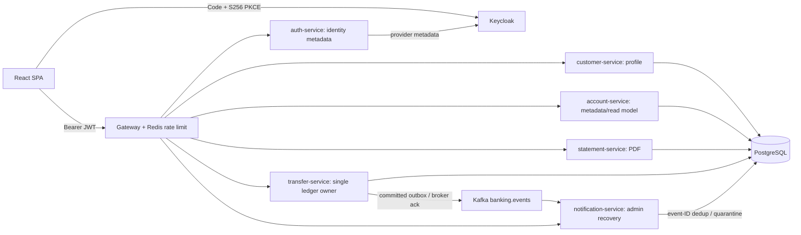
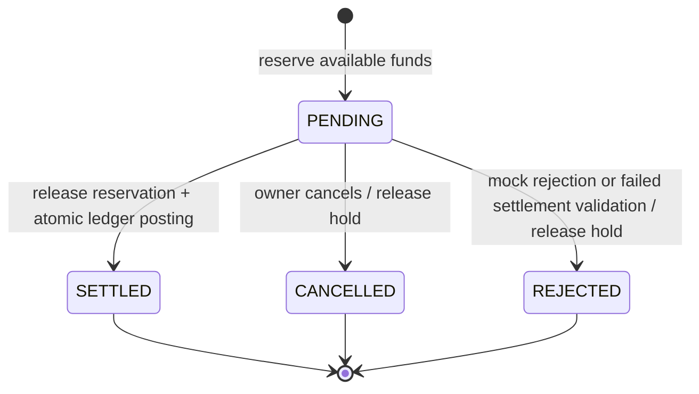
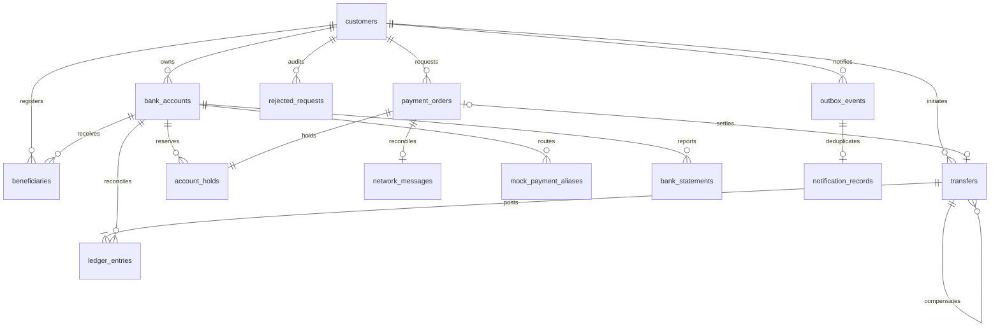

# Architecture and consistency decisions

## Executable topology



Seven Spring Boot processes have distinct routes and independently executable JARs/Dockerfiles. `banking-kernel` is an ordinary shared library: domain read models, validated request contracts, typed public response views, security and designated business modules. Customer/account/statement services import their specific controllers/services. They do not accidentally component-scan financial controllers. Startup boundary tests check that foreign routes remain unavailable.

**ADR 001 — one ledger owner.** Financial postings, balance changes, holds, reservations, orders, compensation, audit and outbox remain in transfer-service's SQL transaction. Account-service opens zero-balance accounts or closes empty accounts; it cannot mint funds or independently debit/credit balances. Customer-service edits profile/contact data; admin KYC/freeze controls are serialized against financial operations. Statement-service reads the ledger under a repeatable-read snapshot. Auth-service exposes provider configuration/session claims; Keycloak alone performs authentication and credential management.

**ADR 002 — shared PostgreSQL, explicit tradeoff.** The simulation uses one database for referential integrity, customer/beneficiary permissions and atomic ledger operations. This is not database-per-service isolation or an exactly-once distributed transaction. Transfer-service alone runs Flyway V1–V6. Other services wait for migration readiness and disable Flyway. A future isolation step should first extract profile/read projections and event contracts, retaining one authoritative ledger owner. Never split debit/credit between independent databases without a correctly designed settlement/reservation protocol.

**ADR 003 — JPA read models and explicit JDBC writes.** JPA provides owned Account queries and version metadata; JDBC makes financial lock order and postings visible. Both participate in Spring-managed transactions against the same datasource. No open-in-view session. JDBC-only services exclude both Hibernate and JPA repository auto-configuration. Public DTOs keep request fingerprints and internal reservation decisions out of customer responses.

## Transfer lifecycle

```mermaid
sequenceDiagram
 participant U as Customer
 participant A as Ledger API
 participant P as PostgreSQL
 participant K as Kafka
 U->>A: POST /transfers + Idempotency-Key
 A->>P: BEGIN; lock customer
 A->>P: Lookup key and canonical payload fingerprint
 alt Existing same request
  P-->>A: Original transfer reference
 else New request
  A->>P: Lock source + destination in ascending UUID order
  A->>P: Validate owner, KYC, beneficiary, status, limits and available funds
  A->>P: Transfer + debit + credit + 2 postings + audit + outbox
  A->>P: COMMIT deferred ledger/balance/hold checks
 end
 A-->>U: Settled transfer or original reference
 loop After commit; retries retained
  A->>K: Publish committed event; await broker acknowledgement
 end
```

Amounts are BigDecimal/NUMERIC(19,2), never binary floating point in financial writes. Customer-row serialization protects idempotency and the RM 25,000 gross daily limit. Both account locks use the same ordering for transfers, pending settlement and reversal. Available funds are book balance minus unreleased holds. Per-transfer limit: RM 10,000. All calendar queries explicitly cast dates to timestamp **before** applying Asia/Kuala_Lumpur; boundary tests cover midnight through 23:59:59.

A transfer has exactly two entries: source `-amount`, destination `+amount`. Deferred triggers verify two balanced postings, exact source/destination/amount metadata, stored balances equal ledger sums, and held values equal active hold sums. Opening fictional funds are offset by a simulation equity account. Ledger/audit and financial transfer/hold fields reject history rewrites. Status changes and hold release timestamps are retained; original financial entries are never deleted. Database owners can still disable triggers: production needs separate migration credentials, narrow grants, backups and an external tamper-evident audit sink.

Idempotency is `(customer,key)` plus a library SHA-256 digest of canonical fields. Same key/payload returns the original result; changed payload gives 409. Keep keys as long as history. HTTP rejections roll back all financial writes; a separate committed rejection record produces one failure event per key/code. Bean-validation errors are rejected before controller execution. The UI retains the same key for uncertain retries.

An administrative reversal creates another two-entry transfer in the opposite direction, links it to the original and marks the original REVERSED. Replays return the existing compensation. Reversal-of-reversal, frozen/closed accounts and insufficient recipient available funds reject safely. Both debited and credited owners can inspect the compensation.

## Scheduled and mock-network orders



Orders accept SCHEDULED or DUITNOW_MOCK. Funds are reserved immediately, with settlement within 90 days; future orders cannot settle early. The worker locks customer, order and accounts, revalidates state/permissions and settles in a transaction. Concurrent cancellation and settlement have one serialized winner. Unexpected infrastructure exceptions roll back and retain PENDING for retry, never partially release/post. A delayed order that no longer fits today's limit is rejected and released.

Mock aliases are an explicit seeded directory. `daniel@example.test` accepts, `reject@example.test` rejects; both point to Daniel's fictional account. A registered beneficiary is mandatory. Accepted network messages record unique references, amount and authoritative ledger transfer; rejections record the reason/reference without postings. This educational network lives inside the simulation, not an actual DuitNow/PayNet integration. Admin reconciliation checks cached balances, balanced postings, holds and network-message links.

Manual admin holds use their own idempotency keys, reserve available funds and release idempotently. Payment-order holds cannot be released through the manual endpoint; cancel/settle the order instead. Closed accounts cannot be reopened, receive funds or lose history. Opening requires verified mock KYC and starts at zero funds.

## Event guarantees and recovery

Publisher uses `FOR UPDATE SKIP LOCKED`, broker `acks=all`, producer idempotence and a committed SQL outbox. A crash after broker acknowledgement but before the published marker can replay. Delivery is **at least once** across SQL/Kafka, not exactly once. Consumer's event-ID primary key and `ON CONFLICT DO NOTHING` make replay harmless; DB commit precedes offset commit.

The production error handler retries transient failures with bounded exponential backoff, then writes a durable quarantine record keyed by topic/partition/offset. It advances only after that write succeeds; a failed recovery store retains the record. Admin can supply a validated corrected event and republish. A deterministic repair event ID makes a crash/repeated repair harmless. Quarantine/original payload, repaired payload, replay time and operator audit are retained. Notification failures cannot undo settled financial transactions. Prometheus exposes pending outbox/orders and quarantined records; structured logs retain failures without credentials/tokens.

## ER diagram



Contacts are in customers rather than a redundant 1:1 table. Identity credentials/authentication events remain in Keycloak. Audit and quarantine records are separate operational histories. Foreign keys, CHECKs, unique references/keys, partial due/pending indexes and per-account/date indexes enforce integrity and query bounds. PDF generation limits periods to one year and at most 5,000 entries, returning a clear rejection rather than truncating totals.

## Versions

Java 21 LTS; Spring Boot 3.5.16 and Spring Cloud 2025.0.3 selected from current published Maven metadata; Boot 4.x excluded to honor the requested 3.x stack. Boot BOM aligns Spring Security, Hibernate, Flyway, Kafka clients, JUnit and Testcontainers. Springdoc 2.8.17, PDFBox 3.0.6. Maven 3.9.11 and Node 24 used for verification.

React 19, TypeScript 5, Vite 7, Tailwind 4, Router 7, Query 5, Hook Form 7, Zod 4, Recharts 3 and keycloak-js 26; lockfile records resolved versions. OTPAuth is a development-only library for the browser MFA test, not custom application cryptography. PostgreSQL 17, Redis 7.4, Kafka 3.9 and Keycloak 26 compose the local stack. Apply patch/image updates and review CI vulnerability findings continuously; these version pins are not a security certification.
