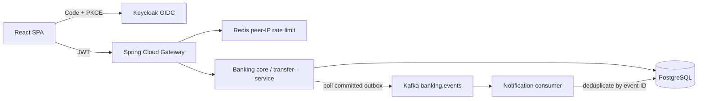
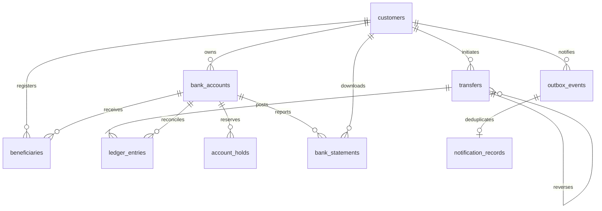

# Architecture decisions

## Executable topology



Authentication belongs to Keycloak, not an invented auth controller. The SPA retains tokens in memory via keycloak-js; the Java API validates signature, issuer, expiry and `banking-api` audience. The gateway applies a Redis token bucket; the core independently enforces authentication and object access.

**ADR 001: one ledger owner.** Keep customer/account/transfer/statement modules within the core until financial invariants and operational requirements justify extraction. A network call cannot make two databases atomic. The gateway and consumer are independently deployable. Planned customer-service owns profile/KYC; account-service would own account metadata while the ledger continues to own balances; statement-service may eventually consume immutable ledger snapshots. No cross-service debit/credit saga is introduced.

**ADR 002: JPA for account read models, JDBC for explicit financial writes.** Spring Data JPA provides typed ownership queries; Spring JDBC exposes lock order and SQL clearly. Both use the same Spring-managed datasource and transaction manager. Controllers, DTOs, domain, repository, service, security and error handling are separated by package. No open-in-view session.

## Transfer lifecycle

```mermaid
sequenceDiagram
  participant C as Customer
  participant A as API
  participant D as PostgreSQL
  participant K as Kafka
  C->>A: POST /transfers + Idempotency-Key
  A->>D: BEGIN; lock customer
  A->>D: Check prior key and payload fingerprint
  alt Same request already settled
    D-->>A: Existing reference
  else New request
    A->>D: Lock source and destination ordered by UUID
    A->>D: Validate ownership, KYC, beneficiary, status, limits, funds
    A->>D: Transfer + debit + credit + 2 postings + audit + outbox
    A->>D: COMMIT (deferred balanced-posting check)
  end
  A-->>C: Settled transfer / original reference
  loop After commit; retry failures
    A->>K: Publish outbox event, await broker acknowledgement
  end
```

A customer row lock protects idempotency lookup and the MYR 25,000 daily gross-outgoing limit in Kuala Lumpur calendar time. Account row locks always use ascending UUID order, including reversals. Held funds reduce available balance. All amounts are `BigDecimal`/`NUMERIC(19,2)`; limit RM 10,000 per transfer. Cross-customer transfers require a previously registered beneficiary; no account data is disclosed by guessing IDs.

Each settled transfer has two signed asset postings whose sum is zero. Customer balances equal the sum of postings on each account. The simulation equity account offsets all opening funds; no money appears without a ledger source. Transfer operations update both balances and both entries in the same transaction; an outbox failure also rolls everything back. PostgreSQL's deferred trigger verifies two balanced postings for each touched transfer at commit. Ledger and audit triggers reject UPDATE/DELETE. Deferred reconciliation guards also require cached balances to equal ledger sums, require every new transfer to have two postings, verify debit/credit metadata against the transfer, and prevent rewriting financial transfer fields. The database role is still trusted; an owner can disable triggers, so production needs narrower grants and external tamper evidence.

Idempotency is scoped by `(customer_id,idempotency_key)` and a SHA-256 fingerprint of canonical request fields. SHA-256 is an established library digest, not custom cryptography. Same payload returns the original transfer, changed payload yields 409. Retain keys for the lifetime of this simulation's history. Only commit can settle; failures roll back, with no saved false success status. HTTP rejections have no financial postings. Failed-transfer notification orchestration is deferred.

Settlement is synchronous. There is no pending state to cancel; 4xx errors reject before settlement. An admin reversal creates another balanced transfer in the opposite direction and retains the original. Reversal is rejected if recipient available funds or account status prevent safe compensation. Reversal-of-reversal is disallowed. The source reference is retained and the original becomes REVERSED. Same reversal request returns its existing compensating transfer.

## Outbox guarantees

Publisher locks unpublished rows using `FOR UPDATE SKIP LOCKED`, publishes with `acks=all` and producer idempotence, then marks the event. A crash after Kafka acknowledgement but before SQL commit can republish. Delivery is **at least once**, not exactly once across Kafka and SQL. Consumer inserts `notification_records` with `ON CONFLICT(event_id) DO NOTHING`; database commit precedes Kafka offset commit, making replay harmless. Transient failures retry. A malformed event currently blocks its partition until repaired; production needs schema versioning, alerting, a dead-letter policy and bounded operational retries. No notification failure can undo an already committed transfer.

## ER diagram



Contacts live in `customers` rather than a redundant 1:1 profile table. Holds schema exists but hold creation/release is not yet exposed. Foreign keys, customer/account indexes, reference uniqueness, source/destination separation, numeric precision and status CHECK constraints enforce basic integrity. Outbox payloads include identifiers and notification text only, never tokens or passwords.

## Dependencies

Java 21 LTS; Spring Boot **3.5.16** and Spring Cloud **2025.0.3** selected from published Maven metadata on 2026-11-11; Boot 4.x intentionally excluded to honor the requested 3.x stack. Springdoc 2.8.17 is on its Boot 3 compatible line. Boot BOM manages Hibernate, Flyway, Kafka client, security, JUnit and Testcontainers. PDFBox 3.0.6 creates real PDFs. Maven 3.9.11 used for validation.

Frontend: React 19, TypeScript 5, Vite 7, Tailwind 4, Router 7, TanStack Query 5, Hook Form 7, Zod 4, Recharts 3, keycloak-js 26, lucide-react. `package-lock.json` records exact installed versions. Node 24 used for validation. PostgreSQL 17, Redis 7.4, Kafka 3.9 and Keycloak 26 are pinned in Compose; refresh patch image pins after security scans. Kafka uses local KRaft mode, no ZooKeeper. No floating-point operations govern financial writes; frontend numeric chart/formatting conversions are display-only.
